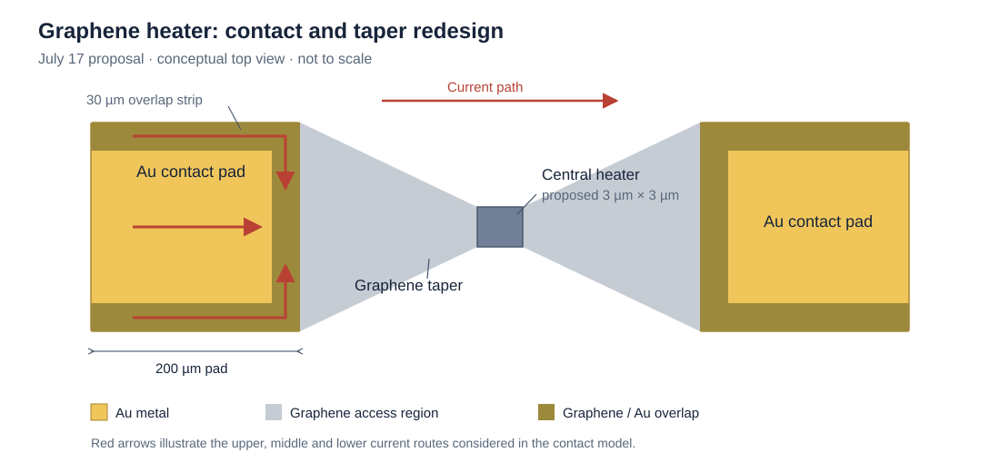

# Graphene Heaters and Electrode Design for Phase-Change Photonics

[Back to SJTU research overview](../README.md)

## Project and contribution

This collaborative SJTU project investigated graphene heaters for electrically addressing Sb–Se phase-change material on photonic waveguides. My exchange contribution included graphene wet transfer, active electrical/optical testing and work on electrode-layout redesign following heater failure.

The design objective was to concentrate useful electrical dissipation near the phase-change region while maintaining graphene continuity, reliable metal contacts and usable optical transmission. The design evolution below also draws on subsequent SJTU group-review notes from July 2026; those calculations and follow-up measurements are identified by stage.

## Initial layout and electrical diagnosis

The current path comprised metal/graphene overlap regions, tapered graphene access regions and a narrow central heater. A representative low-bias check gave approximately **60 μA at 1 V**, corresponding to a total resistance of approximately **16.7 kΩ** and an electrical input power of approximately **60 μW**.

The July 10 group analysis considered devices carrying approximately 60–80 μA at 1 V. It estimated a patterned-graphene resistance of approximately 1.6 kΩ and a combined contact contribution of approximately 11 kΩ. The central section effectively coupled to the phase-change region was estimated at approximately 2 μm in length and approximately 200 Ω. In that simplified budget, only about **1–2% of the total electrical power** was dissipated in the selected central section.

| Quantity | Value / interpretation in the July 10 analysis |
| --- | --- |
| Graphene sheet resistance used in the model | Approximately 500 Ω/□ |
| Patterned graphene, including access regions | Approximately 1.6 kΩ |
| Combined contact-resistance contribution | Approximately 11 kΩ |
| Selected central heating section | Approximately 200 Ω over an effective length of about 2 μm |
| Main design issue | Much of the applied voltage and power was assigned to contacts and access regions |

These were approximate resistance-budget estimates, rather than separate four-terminal extractions of every component.

## Proposed contact and heater geometry

The July 17 proposal extended graphene overlap along three edges of each Au pad. Its contact model considered upper, middle and lower injection routes, each containing an interface contribution and a graphene access resistance.

*Conceptual top view redrawn from the July 17 group design notes. The 200 μm pad, 30 μm overlap strips and 3 μm × 3 μm central section are proposal values. The schematic is not to scale.*

| Design parameter | Proposed revision |
| --- | --- |
| Metal pad dimension in the contact sketch | 200 μm |
| Graphene overlap strips in the July 17 proposal | 30 μm |
| Central rectangular graphene width | 4 → 3 μm |
| Central rectangular graphene length | 10 → 3 μm |
| Taper extent along the current direction | 13.5 μm |
| Combined objective | Reduce unwanted contact/access voltage drops while redistributing dissipation towards the intended heater |

The overlap geometry and heater dimensions were design variables. Different revisions were assessed through calculation and subsequent fabrication feedback.

## Resistance and power model

For a simplified series path,

$$
R_{\mathrm{tot}}
=R_{\mathrm{c1}}+R_{\mathrm{a1}}+R_{\mathrm{h}}+R_{\mathrm{a2}}+R_{\mathrm{c2}},
$$

where the contact terms are Rc1 and Rc2, the graphene access/taper terms are Ra1 and Ra2, and Rh represents the selected heating section. At a common current,

$$
P_{\mathrm{h}}=I^2R_{\mathrm{h}},
\qquad
\frac{P_{\mathrm{h}}}{P_{\mathrm{tot}}}
=\frac{R_{\mathrm{h}}}{R_{\mathrm{tot}}}.
$$

At fixed applied voltage, the same model gives

$$
P_{\mathrm{h}}=\frac{V^2R_{\mathrm{h}}}{R_{\mathrm{tot}}^2}.
$$

This makes the contact contribution important even when the goal is to heat a small central region. These expressions describe electrical dissipation; the phase-change material's temperature also depends on heat flow through the surrounding stack.

A uniform-sheet estimate gives a rectangular graphene resistance R = RsL/W. For a linear taper under a quasi-one-dimensional approximation,

$$
R_{\mathrm{taper}}
=R_{\mathrm{s}}\frac{L}{W_{\mathrm{wide}}-W_{\mathrm{narrow}}}
\ln\left(\frac{W_{\mathrm{wide}}}{W_{\mathrm{narrow}}}\right).
$$

The July 17 calculations estimated approximately 0.78 kΩ for the revised graphene channel and tapers, compared with approximately 1.5 kΩ in the earlier estimate. A total device resistance of **2–3 kΩ** was a design target conditional on improving the contacts and transfer process.

## Follow-up group measurements: C-shaped overlap

The July 31 group report recorded results from a subsequent C-shaped graphene batch. Approximately **18 of 34 devices** were electrically conductive. The largest reported current was approximately **40 μA at 1 V**; several devices carried only a few microamperes.

| Assessment | Result reported in the July 31 notes |
| --- | --- |
| Lumped three-branch model | Approximately 3.35 kΩ total resistance |
| Reported device resistance | Approximately 25–30 kΩ |
| Best current in the C-shaped batch | Approximately 40 μA at 1 V |
| Earlier non-C-shaped comparison | A maximum of approximately 170 μA at 1 V in the cited earlier batch |

The C-shaped revision therefore did not achieve the predicted resistance reduction in that batch. The later contact sketch also used revised strip/access dimensions, so these results belong to the follow-up geometry rather than validating every dimension of the July 17 proposal.

Sharp inner turns, nonuniform metal/graphene contact, transfer residue and graphene continuity were considered as possible contributors to the discrepancy. The lumped branch model did not resolve detailed two-dimensional current flow around the contact corners. These remained failure-analysis hypotheses requiring targeted checks.

The group proposed further iterations using rounded transitions, avoiding unsupported graphene sections, investigating annealing, and evaluating a graphene-first / metal-on-top contact sequence.

Thermal-model scenarios discussed alongside the electrode redesign

The July 17 notes also included thermal simulations driven by prescribed heat-source pulses. Example scenarios used approximately **8 mW over 5 μs** for a RESET-oriented calculation and **3 mW over 90 μs** for a SET-oriented calculation. Electrical drive estimates assumed a 500 Ω heating section and a total resistance of 2–3 kΩ.

These were simulation inputs and design estimates. They describe the thermal-model study, with experimental switching performance requiring its own electrical and optical measurements.

## Experimental implications

| Workstream | Question to resolve |
| --- | --- |
| Contact and transfer process | How much resistance originates at the interface, and how reproducibly can it be reduced? |
| Patterned graphene continuity | Do tears, residue or poorly supported regions account for device-to-device variation? |
| Current distribution | Does a revised overlap or rounded transition reduce localized bottlenecks? |
| Heating and optical testing | Does the electrical pulse produce a reproducible optical state change while preserving the heater? |

The project connected material transfer, contact engineering and thermal actuation. Its design cycle illustrates how a plausible resistance model can guide a layout proposal, while measurements determine which assumptions need revision.

*Design-review sources: Yunjie Li, SJTU group-meeting presentations dated July 10 (slides 2–7), July 17 (slides 3–8) and July 31 (slides 3–6), 2026. The group calculations and later batch measurements above provide collaborative project context.*
