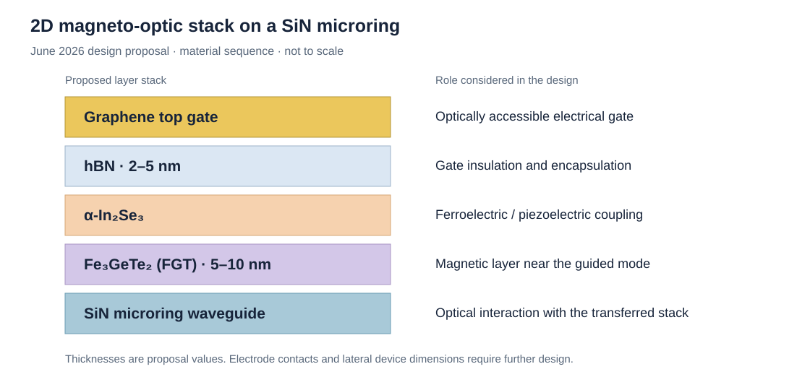

# 2D Heterostructures for Magneto-Optic Modulator Concepts

[Back to SJTU research overview](../README.md)

**Stage: exploratory device design and integration planning**

I investigated how ferromagnetic and ferroelectric van der Waals materials might be integrated with a SiN microring to provide electrical control of its magneto-optic response. The work covered material assessment, several gate-stack concepts and a proposed dry-transfer assembly sequence.

The study developed a candidate architecture and identified practical constraints involving optical absorption, magnetic operating conditions, electrical gating and the number of transfer steps.

## Candidate material stack

The June design used Fe₃GeTe₂ (FGT) near the waveguide, α-In₂Se₃ as the ferroelectric component, hBN for insulation/encapsulation, and a graphene top gate.

*Layer sequence redrawn from my June 5 and June 12 design slides. The hBN and FGT thicknesses are proposal values, and the schematic is not to scale.*

| Component | Role considered | Integration question |
| --- | --- | --- |
| Graphene gate | Electrically address the stack with less metal coverage over the optical region | Gate continuity, contacts and optical overlap |
| hBN | Gate insulation and environmental protection | Voltage partition across the gate stack and reliable encapsulation |
| α-In₂Se₃ | Ferroelectric / piezoelectric coupling to the adjacent magnetic layer | Coupling strength and reproducibility at the assembled interface |
| FGT | Magnetic layer interacting with the evanescent optical field | Magnetic operating conditions, absorption and interaction length |
| SiN microring | Photonic platform for reading a material-induced optical change | Material placement, added loss and preservation of the resonance |

## Architecture development

| Meeting record | Design focus |
| --- | --- |
| April 30 | Compare single- and dual-gate concepts for electrical control of a magnetic layer near a waveguide |
| May 15–29 | Assess the trade-off between optical overlap with the magnetic material and absorption; consider local/lateral gate placement |
| June 5–12 | Develop the graphene-gated stack and a staged dry-transfer process, with encapsulation and material handling included in the layout discussion |

The design evolved from a metal-top-gate concept towards a graphene gate. It also brought material protection and transfer order into the architecture discussion, since the magnetic layer, ferroelectric layer and gate must be assembled without compromising the photonic structure.

## Proposed assembly sequence

1. Prepare the SiN microring platform.
2. Exfoliate and locally place FGT under an inert environment.
3. Transfer α-In₂Se₃ over the FGT, with handling and coverage considered together.
4. Add the hBN insulation/encapsulation layer.
5. Integrate the graphene top gate and its contacts.

An Ar anneal at 120 °C for 2 hours appeared as a proposed condition in the June planning notes. The sequence above records the fabrication plan developed for this concept.

My practical graphene-transfer experience is described in the [phase-change heater project](graphene-pcm-heaters.md#graphene-wet-transfer-workflow).

## Physical motivation and feasibility

The literature review connected two separate ideas: voltage-controlled magnetism in FGT/In₂Se₃ heterostructures and magneto-optic interaction between transferred magnetic materials and integrated resonators.

Eom et al. reported strain-mediated voltage control of magnetic coercivity in Fe₃₋ₓGeTe₂/In₂Se₃ heterostructures [1]. This provides a material-level motivation for investigating interfacial coupling. Dushaq et al. studied a different material system, CCPS integrated with silicon microrings, for a magnetically induced non-reciprocal optical response [2].

The proposed FGT/α-In₂Se₃/SiN structure combines additional electrical, magnetic and optical requirements. Its central feasibility questions were:

- Whether the transferred stack provides enough interaction with the guided mode while preserving a usable resonance.
- How magnetic operating conditions and magnetization orientation relate to the intended optical response.
- How much voltage reaches the functional layers through the multilayer gate stack.
- Whether repeated alignment, encapsulation and contact steps can be implemented reliably.

This project remained an exploratory design study. Its contribution was the architecture comparison, material/integration assessment and assembly planning used to judge whether the concept should progress to a more complex device.

## Sources

Project records: my group-meeting slides from April 30, May 15, May 22, May 29, June 5, June 12 and June 18, 2026. Literature figures in those slides served as references; the stack illustration above is a new schematic of the proposed architecture.

1. J. Eom et al., “Voltage control of magnetism in Fe₃₋ₓGeTe₂/In₂Se₃ van der Waals ferromagnetic/ferroelectric heterostructures,” *Nature Communications* **14**, 5605 (2023). [DOI: 10.1038/s41467-023-41382-8](https://doi.org/10.1038/s41467-023-41382-8).
2. G. Dushaq et al., “Non-reciprocal response in silicon photonic resonators integrated with 2D CuCrP₂S₆ at short-wave infrared,” *Light: Science & Applications* **14**, 157 (2025). [DOI: 10.1038/s41377-025-01826-w](https://doi.org/10.1038/s41377-025-01826-w).
