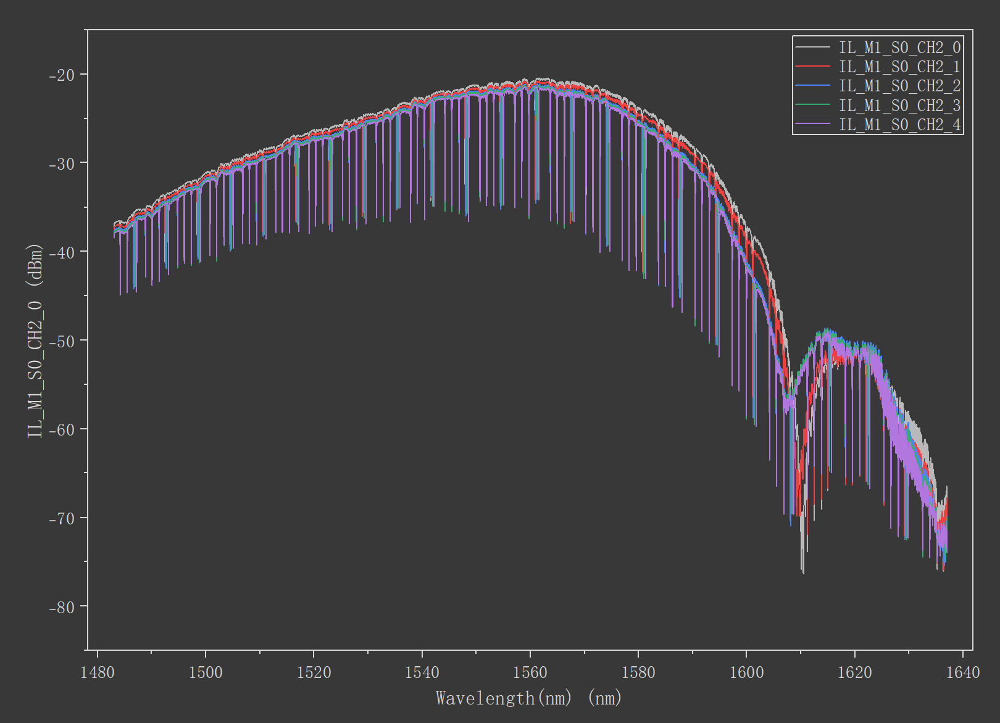
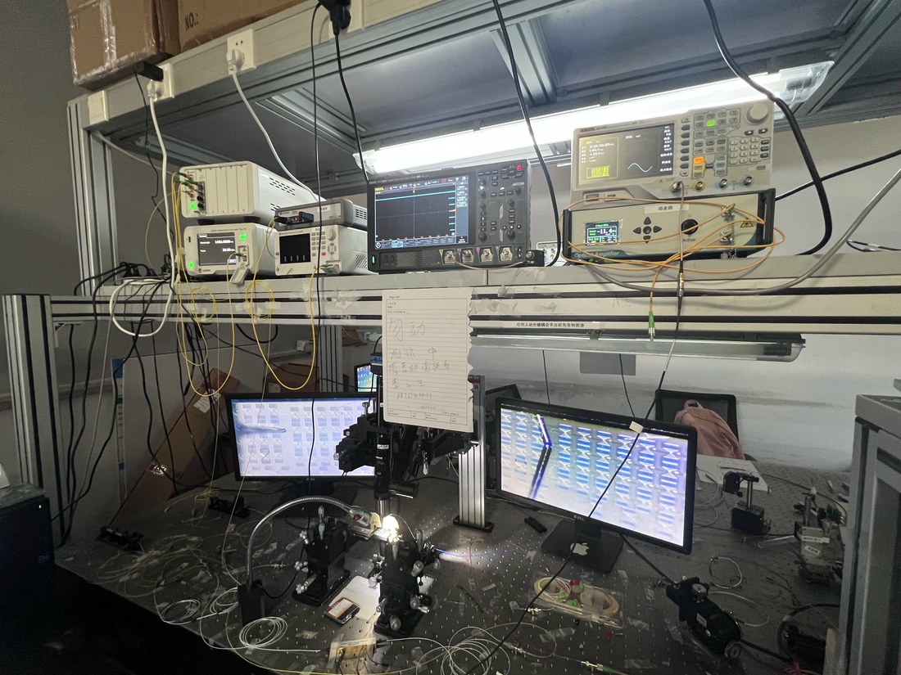

# Silicon Microring Arrays: Thermal Tuning and Matrix Computation

[Back to SJTU research overview](../README.md)

## Project and contribution

During my SJTU exchange, I worked on matrix–vector multiplication (MVM) experiments using silicon microring-resonator arrays. My activities connected CNN-kernel-to-matrix mapping with transmission-spectrum measurements and optical-output-power characterization.

My meeting records also document passive spectral measurements, thermal tuning of a multi-ring device and a nine-ring platform used for CNN-related experimental work. These records connect the computational mapping with the optical devices and measurement hardware.

## Multi-ring thermal-tuning measurements

The April 17 record describes a heater-voltage scan from **0 to 4 V in 0.5 V steps**. The notes identify the fourth microring as the addressed ring and record a shift of its resonance towards longer wavelengths as the heater bias increased.

*Selected original transmission traces from the April 17 meeting record. The image preserves the instrument's wavelength and dBm-axis labels. The voltage range and step size describe the recorded test protocol.*

This work involved locating resonances in a spectrum containing multiple periodic dips, varying the electrical drive and tracking the selected resonance. The spectra provided a direct view of how a control voltage changed the optical response.

## Nine-ring experimental platform

The May 29 meeting record describes active experimental work on a **nine-microring** platform in a CNN context. The measurement setup combined optical spectral measurements with electrical waveform generation.

*Original photograph from my May 29 meeting record.*

| Activity | Connection to the experiment |
| --- | --- |
| Map CNN kernels into matrices | Express the target convolution for the matrix-computation experiment |
| Measure transmission spectra | Identify the optical response and resonances of the array |
| Apply electrical drive | Investigate how programmed excitation changes device behaviour |
| Measure optical output power | Record the hardware response associated with the experiment |
| Relate mapping and measurements | Connect the intended matrix operation with the optical data |

## Experimental perspective

The work developed my experience moving between a mathematical operation and the response of physical photonic hardware. The thermal-tuning records provide a concrete example of electrical control and spectral readout; the nine-ring work extended the experimental context towards matrix computation.

Project records: my April 10 and April 17 meeting slides for passive/thermal measurements, and May 29 slides for the nine-ring CNN-related platform.
